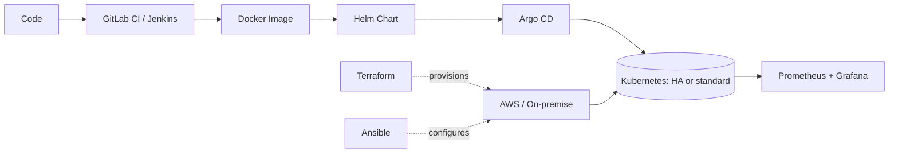
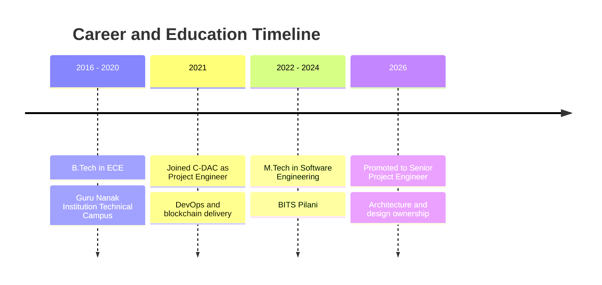
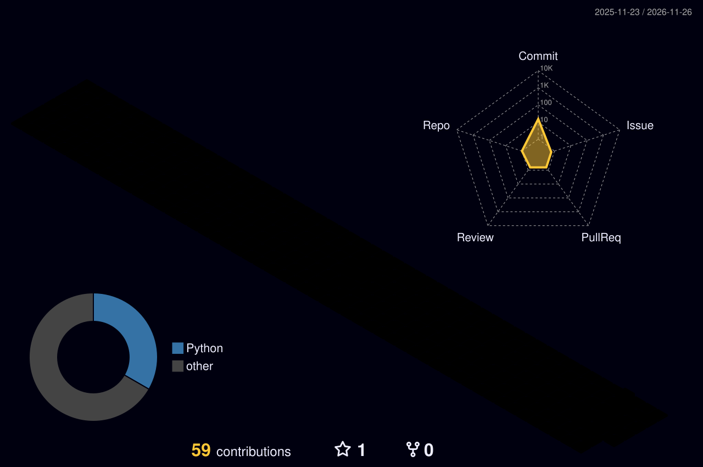

<div align="center">



<a href="https://github.com/AmeerRiyaz">
  
</a>

<p align="center">
  
  
  
  
  
  
</p>

<p align="center">
  
  
  
</p>

<p align="center">
  <a href="#about"></a>
  <a href="#pipeline"></a>
  <a href="#toolbox"></a>
  <a href="#journey"></a>
  <a href="#certs"></a>
  <a href="#stats"></a>
  <a href="#contact"></a>
</p>

<p align="center">
  <a href="./Shaik_Ameer_Riyaz_Resume.pdf"></a>
</p>

</div>

---

<h2 align="center"><a id="about"></a>⚙️ About Me</h2>

<p align="center">
I design, build and run distributed applications for government and enterprise clients at <b>C-DAC, Hyderabad</b>.<br/>
I own solution architecture and design, build HA and standard Kubernetes clusters on AWS and on-premise,<br/>
and automate everything with Terraform and Ansible. My domain specialty is <b>Hyperledger Fabric</b> and <b>Besu</b>.
</p>

```hcl
# profile.tf
locals {
  engineer = {
    name         = "Ameer Riyaz"
    role         = "Senior Project Engineer @ C-DAC"
    location     = "Hyderabad, India"
    experience   = "5+ years"
    focus        = ["IaC", "Kubernetes HA", "CI/CD + GitOps", "Event-driven backends"]
    domain       = ["Hyperledger Fabric", "Hyperledger Besu"]
    certified    = ["CKAD", "Fabric Practitioner", "Besu Professional"]
    open_to_chat = true
  }
}
```

---

<h2 align="center"><a id="pipeline"></a>🔄 How I Ship</h2>



<h3 align="center">⚡ Live Pipeline</h3>

<div align="center">


</div>

---

<h2 align="center"><a id="toolbox"></a>🧰 DevOps Toolbox</h2>

<div align="center">


<br/><br/>


</div>

<details>
<summary><b>📋 Full stack breakdown (click to expand)</b></summary>

<br/>

| Area | Stack |
|---|---|
| ☁️ **Cloud (AWS)** | EC2, EKS, ECS/Fargate, Lambda, VPC, IAM, S3, RDS, DynamoDB, CloudWatch, ELB/ALB, Route 53, SNS/SQS, WAF, CloudTrail |
| 🏗️ **Infrastructure as Code** | Terraform (reusable modules), Ansible |
| ☸️ **Containers & Orchestration** | Docker, Kubernetes, Helm, Ingress, RBAC, HPA, PV/PVC |
| 🔁 **CI/CD & GitOps** | GitLab CI, Jenkins (shared libraries), Argo CD |
| 📨 **Messaging & Streaming** | Apache Kafka, ActiveMQ, SNS/SQS |
| 📊 **Monitoring** | Prometheus, Grafana, AWS CloudWatch |
| 💻 **Backend** | Node.js, Express.js, Python, FastAPI, MongoDB |
| 🔗 **Blockchain** | Hyperledger Fabric, Hyperledger Besu, Solidity, IPFS |

</details>

---

<h2 align="center">🚀 What I Do</h2>

| Focus | Details |
|---|---|
| 🏛️ **Architecture & design** | Service boundaries, API contracts, data layers, Kubernetes topology and CI/CD workflows |
| 🖥️ **Infrastructure** | HA and standard Kubernetes clusters and servers on AWS and on-premise with Terraform and Ansible |
| 🔄 **Delivery pipelines** | Helm-based releases, Argo CD GitOps and reusable Jenkins pipeline libraries |
| 🔗 **Blockchain delivery** | 10+ production apps on Hyperledger Fabric and Besu: document verification, digital identity, e-voting, supply-chain audit |
| 🎓 **Mentoring** | Design reviews and training on Kubernetes, Docker, Helm, Ansible and infrastructure automation |

---

<h2 align="center"><a id="journey"></a>🧭 My Journey</h2>



---

<h2 align="center"><a id="certs"></a>🏅 Certifications</h2>

<p align="center">
  <a href="https://www.credly.com/badges/ebfce6d5-e235-4207-82f9-30904af68db5"></a>
  <a href="https://www.credly.com/badges/9b81a7a3-294f-4f9b-bfde-67b0cc3b6bd1"></a>
  <a href="https://www.credly.com/badges/f96ae64a-c0ba-4730-86f1-a619c6a26471/public_url"></a>
</p>

<p align="center">
📄 <b>Publication:</b> <a href="https://iaeme.com/Home/article_id/IJBT_03_02_002">Blockchain Based Digital Signature Certificate Management System</a><br/>
🎓 <b>Education:</b> M.Tech in Software Engineering, BITS Pilani | B.Tech in ECE, Guru Nanak Institution Technical Campus
</p>

---

<h2 align="center"><a id="stats"></a>📈 GitHub Stats</h2>

<p align="center">
  
  
</p>

<p align="center">
  
</p>

<p align="center">
  
</p>

<p align="center">
  
</p>

<!-- <h3 align="center">🏙️ 3D Contribution Skyline</h3>

<p align="center">
  
</p> -->

<h3 align="center">🐍 Contribution Snake</h3>

<p align="center">
<picture>
  <source media="(prefers-color-scheme: dark)" srcset="https://raw.githubusercontent.com/AmeerRiyaz/AmeerRiyaz/output/github-snake-dark.svg" />
  <source media="(prefers-color-scheme: light)" srcset="https://raw.githubusercontent.com/AmeerRiyaz/AmeerRiyaz/output/github-snake.svg" />
  
</picture>
</p>

---

<h2 align="center"><a id="contact"></a>💬 Let's Connect</h2>

<p align="center">
  <a href="mailto:ameerriyaz25@gmail.com"></a>
  <a href="https://in.linkedin.com/in/ameer-riyaz"></a>
  <a href="https://twitter.com/AmeerRiyaz111"></a>
  <a href="./Shaik_Ameer_Riyaz_Resume.pdf"></a>
</p>

<p align="center"><i>Infrastructure should be code, deployments should be boring, and clusters should survive a node failure.</i></p>
